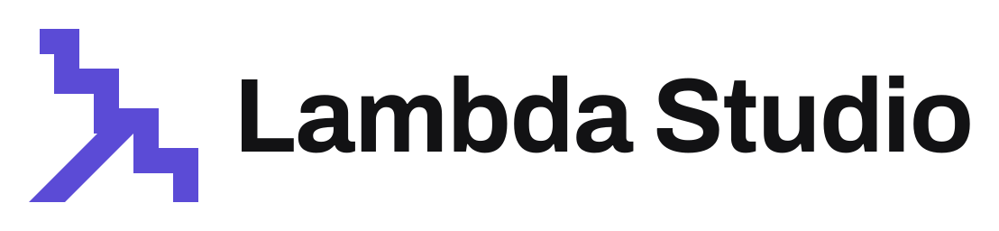

<p>
  <picture>
    <source media="(prefers-color-scheme: dark)" srcset="lambda-studio/docs/assets/lockup-horizontal-dark.svg">
    
  </picture>
</p>

A browser workbench for the untyped λ-calculus. Write a term in almost any notation, step through its reduction, watch John Tromp's diagram of it change, convert it to other notations, and export the results.

**Try it: <https://almer113.github.io/lambda-studio/>.** It runs entirely in your browser, and you can install it as an app that works offline.

## What's here

| Folder or file | What it is |
|---|---|
| [`lambda-studio/`](lambda-studio/) | The app: source, tests and docs. Start with its [README](lambda-studio/README.md) |
| [`lambda-studio/docs/USER_GUIDE.md`](lambda-studio/docs/USER_GUIDE.md) | How to use it |
| [`lambda-studio/docs/FORMATS.md`](lambda-studio/docs/FORMATS.md) | The notations it reads and writes |
| [`PLAN.md`](PLAN.md) | The plan it was built from |
| [`Lambda_Calculus_Research_Report.md`](Lambda_Calculus_Research_Report.md) | Background: how the λ-calculus works, its notations and diagrams |
| [`Lambda_Calculus_Tools_Catalogue.md`](Lambda_Calculus_Tools_Catalogue.md) | Other λ-calculus tools |

## Running it yourself

You need [Node.js](https://nodejs.org) 20 or newer.

```bash
git clone https://github.com/Almer113/lambda-studio.git
cd lambda-studio/lambda-studio
npm install
npm run dev
```

Then open <http://localhost:5173>. To get updates later: `git pull`, then `npm install`. The app's [README](lambda-studio/README.md) covers the tests, the builds, a permanent local copy and GitHub Pages.

## Licence

[MIT](LICENSE).
