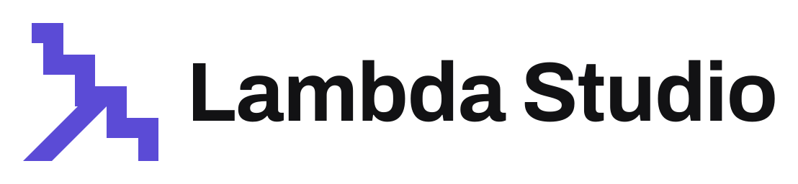
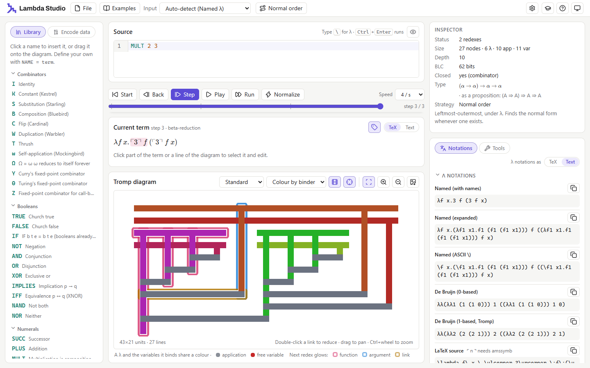

<p>
  <picture>
    <source media="(prefers-color-scheme: dark)" srcset="docs/assets/lockup-horizontal-dark.svg">
    
  </picture>
</p>

# Lambda Studio

A browser workbench for the untyped λ-calculus: write a term in almost any notation, step through its reduction, watch John Tromp's diagram of it change, convert it to other notations, and export the results.

- **Try it:** <https://almer113.github.io/lambda-studio/> (nothing to install; it runs in your browser, and can be installed as an app that works offline)
- **Guide:** [docs/USER_GUIDE.md](docs/USER_GUIDE.md)
- **Notations:** [docs/FORMATS.md](docs/FORMATS.md)

<picture>
  <source media="(prefers-color-scheme: dark)" srcset="docs/assets/screenshot-dark.png">
  
</picture>

## The interface

- **Header:** File, Examples, the input format and a **Strategy** button that names the current choice ("Normal order", "… + η"). On the right: Settings, the tutorial, help and the theme.
- **Left column:** **Library** and **Encode data** as two tabs. Library rows show a short description; the full text is in the tooltip.
- **Centre column:**
  - **Source**, with starter examples when the source is empty. If a line has an error, the app says which definition it is showing instead.
  - **Playback:** Start, Back, Step, Play, Run and Normalize, a speed menu, and a timeline (with a tick per step for runs of up to 80 steps).
  - **Current term.**
  - **Tromp diagram:** it fills the remaining height, so the diagram and its legend fit a 1440×900 screen.
    - The next redex is outlined in pink (function), blue (argument) and yellow (link), while the lines keep their own colours.
    - Selecting a part dims the rest and boxes the selection.
- **Edit bar:** appears at the bottom when you select a subterm. It sits over the centre column, with its actions in groups (Reduce, Wrap, Change, Name); the page keeps room below it so it doesn't cover the diagram.
- **Right column:**
  - **Inspector.**
  - **Notations:** one TeX/Text switch for the panel, and a copy menu per row (text or LaTeX).
  - **Tools:** a **Tool** menu for Expression → λ, Truth table, Number table, Laws, Data types and Generate. When the term suits another tool (a Boolean function in the Number table, say), a note offers to switch.
- **Tablets** (640–860 px) get two columns, with a one-row diagram toolbar.
- **Phones:**
  - Sections are tabs: Edit, Diagram, Tools, Notations and Library.
  - The input format and strategy are in the **⋯** menu.
  - The Diagram tab shows the source as a strip you can expand, then the controls and the diagram, with the current term below it.
  - The diagram toolbar fits on one row, with the rest in its own **⋯** menu.
- **Tutorial:** opens on the first visit, as a drawer on the right that moves aside when it covers what a lesson points at.

Light and dark themes follow the system or the theme button.

## Running it

**Requirements:** [Node.js](https://nodejs.org) 20 or newer (it is developed on Node 24) and git. The browser tests also need Google Chrome (or Edge, with `PW_CHANNEL=msedge`).

```bash
git clone https://github.com/Almer113/lambda-studio.git
cd lambda-studio/lambda-studio
npm install
npm run dev            # http://localhost:5173
```

The repository's top folder holds the research notes and the plan; the app is in `lambda-studio/`, and every command below runs there.

**Getting updates:** `git pull`, then `npm install` (in case the dependencies changed), and restart `npm run dev`, or run `npm run deploy` for your own copy (below).

| Command | What it does |
|---|---|
| `npm run dev` | Development server with hot reload |
| `npm test` | Unit, property and golden tests (Vitest) |
| `npm run test:e2e` | Browser tests (Playwright): layout at desktop, tablet and phone sizes, the edit bar, menus and tools |
| `npm run typecheck` | TypeScript check |
| `npm run build` | Production build in `dist/` |
| `npm run build:single` | One self-contained `dist-single/index.html` (about 3 MB) that works offline, from a USB stick or as an e-mail attachment |

## GitHub Pages

The public site is built and published by `.github/workflows/pages.yml` (in the repository's top folder) on every push to `main`. The same workflow type-checks, runs the unit tests and builds on every push and pull request. The browser tests aren't run there, since they check layout widths with Windows fonts.

The site lives under the repository's name, so the workflow builds with `BASE_PATH=/lambda-studio/`; icons, the manifest, the service worker and its file list all follow it. `SITE_URL` gives the link-preview image its full address. To build it the same way locally:

```bash
BASE_PATH=/lambda-studio/ SITE_URL=https://almer113.github.io/lambda-studio/ npx vite build
```

(In Git Bash on Windows, run that from PowerShell instead: Git Bash turns `/lambda-studio/` into a Windows path.)

## A permanent local copy (and Tailscale)

The deployed copy is separate from the dev server: it serves a build kept in `deploy/`, so work in progress never breaks it.

| Command | What it does |
|---|---|
| `npm run deploy` | Type-check and build into `deploy/releases/<time>-<commit>/`, then point `deploy/current.txt` at it. The running server switches at once (no folder in use is renamed, which Windows refuses). The previous release is kept, older ones removed; `/version.txt` on the site names the live commit |
| `npm run serve` | Serve the current release on `http://127.0.0.1:4180` (`--port`, `--host` to change). No dependencies; gzips text files and caches the hashed assets |

**Starting and stopping it.** `node scripts/server-control.mjs start` serves the current release in the background (no window; log in `data/server.log`) and does nothing if it is already running. `stop` stops this app's server and nothing else, and `status` prints one line of JSON. The server records itself in `data/server-4180.json` (pid, start time and a random token) and answers `/api/health`; `stop` asks it to shut down with that token. All three can be run by other tools too: they need no window or keyboard, and `start` and `stop` exit 0 on success and print a one-line reason otherwise.

**Starting at logon (Windows).** `scripts/start-server.vbs` runs `server-control.mjs start` with no window. A shortcut to it in the Startup folder (`shell:startup`) runs it at logon.

**Tailscale.** The server listens on 127.0.0.1 only. Tailscale publishes it to your tailnet over HTTPS (HTTPS matters: copying share links needs a secure page):

```bash
tailscale serve --bg --https=8443 http://127.0.0.1:4180
```

The app is then at `https://<machine>.<tailnet>.ts.net:8443/` from any device on the tailnet. The setting survives reboots. `tailscale serve status` lists it; `tailscale serve --https=8443 off` removes it.

**Installing it as an app.** The site has a web app manifest ("Lambda Studio", with the Step λ icon) and a service worker, so Chrome and Edge offer **Install** in the address bar (on Android, *Add to Home screen*; on iOS Safari, *Share › Add to Home Screen*). Installing needs HTTPS, so use the Tailscale address (or `localhost` on the same computer). The installed app opens in its own window and works offline: the service worker caches the whole build (`precache.json`, written by the build) and updates itself to the newest deploy on the next start. The icons in `public/`, the logos in `docs/assets/` and the header's wordmark (`src/ui/Wordmark.tsx`) are copied from the finished brand kit (the "Step λ" mark); they are not generated here.

Settings and the source are saved per address, so `localhost:4180`, the Tailscale address and the dev server each remember their own.

## Layout of the code

```
src/core/          pure TypeScript, no DOM: terms, parsers and printers, reduction,
                   diagrams, combinators, algebra tools, generators, types
src/core/formats/  one module per notation
src/core/diagram/  Tromp layouts (standard and alternative), SVG/TikZ/Typst, morphs
src/core/algebra/  expressions, truth tables, number tables, laws
src/worker/        background evaluation (step engine, fast normalizer, tools)
src/ui/            React interface; styles.css starts with the design tokens (control
                   heights, font sizes, radii, colours for both themes)
tests/             Vitest; tests/golden/tromp.json holds diagrams from Tromp's own tool
e2e/               Playwright browser tests
scripts/           make-golden.mjs regenerates the golden file (needs GHC and tromp/AIT)
```

## Licence

MIT: see [LICENSE](../LICENSE). The libraries it uses are MIT or ISC licensed; the wordmark is Archivo (SIL Open Font License), converted to outlines.

## Credits

Diagrams follow John Tromp's description and are checked against the output of his [AIT](https://github.com/tromp/AIT) tools. Typesetting by [KaTeX](https://katex.org), math input by [MathLive](https://cortexjs.io/mathlive/), GIF encoding by [gifenc](https://github.com/mattdesl/gifenc).
